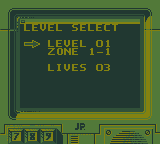
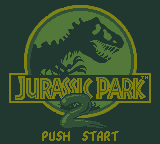
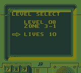
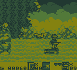

# Jurassic Park Part 2 - Level Select

A Game Boy ROM hack by **wavedout**. Version **1.0** — November 17, 2026.

Adds a level select to Jurassic Park Part 2: The Chaos Continues, using the game's original computer-screen design.

- Select any of the game's 15 stages, including boss fights and T-Rex pursuits
- Choose how many lives to start, ranging from 3 to 99
- Menu supports English, Italian, French, and German
- Original briefings, cutscenes, and stage transitions remain intact

## Controls

- **Up/Down:** Choose LEVEL or LIVES.
- **Left/Right:** Change the selected value.
- **A or Start:** Confirm and launch the selected stage.
- **A or Start** also skips the opening copyright screen and confirms menu choices.

Lives choices: **3, 5, 7, 10, 20, 30, 40, 50, 60, 70, 80, 90, 99**.
Continues restore the selected starting-life count. Extra-life awards cap at 99.

The selector follows the game's language choice. The original game's other text remains as originally released.

## Patching

Apply the BPS or IPS patch in `patches/` to a clean copy of:

`Jurassic Park Part 2 - The Chaos Continues (USA, Europe) (En,Fr,De,It).gb`

BPS is recommended because it validates the source ROM. No game ROM is included.

| Source ROM hash | Value |
|---|---|
| CRC32 | `AF3D2E95` |
| MD5 | `B94EB524347BB0A8A5C151B59AD63CFA` |
| SHA-1 | `B3DF5F3BF73B42696261247C4C9C425A81322BB0` |
| SHA-256 | `d1f49235704e86070bcd04569be7d2d58643cc4021b1f7bc9eb5133e27457329` |

## Screenshots

| Level Select | Title screen |
|---|---|
|  |  |

| Starting lives | Gameplay |
|---|---|
|  |  |

## Testing

Verified with SameBoy 1.0.4's Game Boy and Game Boy Color cores: all four languages and 15 stage launches, all 13 lives choices, continues, game over, original transitions, ending and credits. Original-versus-hack comparisons matched graphics and audio across 27,000 gameplay frames.

Progression and exhaustive lives checks used controlled completion/death triggers. This was not an unassisted playthrough or physical-hardware test. See [TESTING.md](TESTING.md) for details.

## Credits

Hack by **wavedout**. Jurassic Park Part 2: The Chaos Continues and all original game content belong to their respective rights holders. This fan-made release contains patches only.
